# JotLock

**Capture notes from the Android lock screen — jot it, lock it.**

[](../../releases)
[](../../actions/workflows/ci.yml)
[](LICENSE)

<p align="center">
  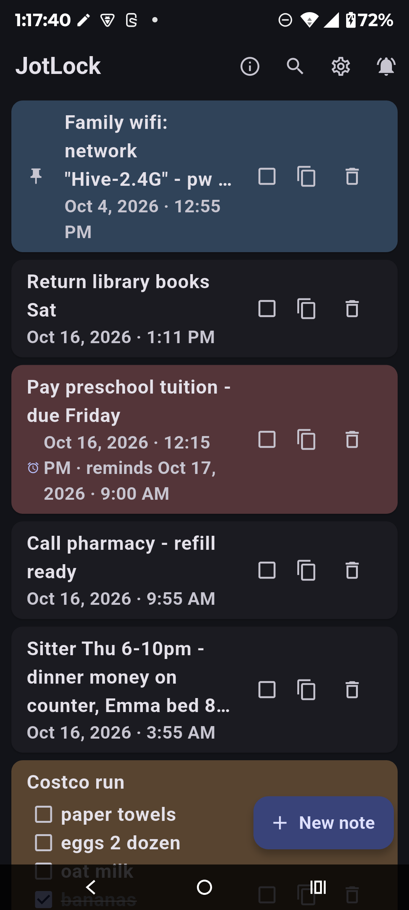
</p>

JotLock is a fast, no-nonsense notes app built around one idea: all the magic
starts from the lock screen. A persistent **Quick note** notification gives
you a **Write note** button right there, so writing a note starts **from**
the lock screen; an inline **Jot** field waits in the shade; and per-note
**reminders** always play your sound but never clutter your lock screen.

One honest detail: tapping **Write note** asks for your PIN or fingerprint
before the note screen opens — the same keyguard rule every app that surfaces
over the lock screen must honor. That's not JotLock being difficult, that's
the security working: someone holding your locked phone can't jot anything
into your notes.

- **Capture from the lock screen** — tap **Write note** and start a note straight **from** the lock screen; the keyguard check (if you use one) keeps strangers out of your notes
- **Re-locks itself** — when you're done, the phone goes back to locked, instantly
- **Private by design** — no accounts, no cloud, no internet permission. Notes never leave the device.
- **Free and open source** — inspect every line.

Latest release: **v1.4.0** · Requires Android 7.0+

---

## Highlights

### Capture from the lock screen

Tap the jot pencil and start writing straight from the lock screen — notes
save without unlocking, and the phone re-locks itself the moment you're
done. Unlocking, finding an app, waiting for it to load: gone. With a PIN or
fingerprint set, Android confirms it's you before the capture screen opens —
an OS rule for every app that surfaces over the lock screen, and the reason
nobody can write into your notes from a locked phone.

<p align="center">
  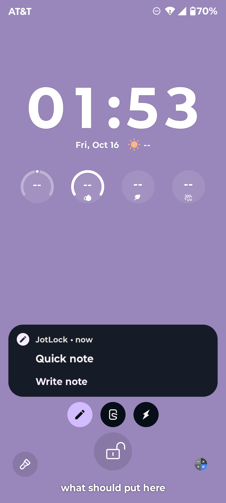
</p>

### Capture from anywhere (inline Jot)

While browsing any app, pull down the shade and tap **Jot** — a text field expands
right there. Send, and you're back where you were. The note is saved; nothing on
screen changes.

<p align="center">
  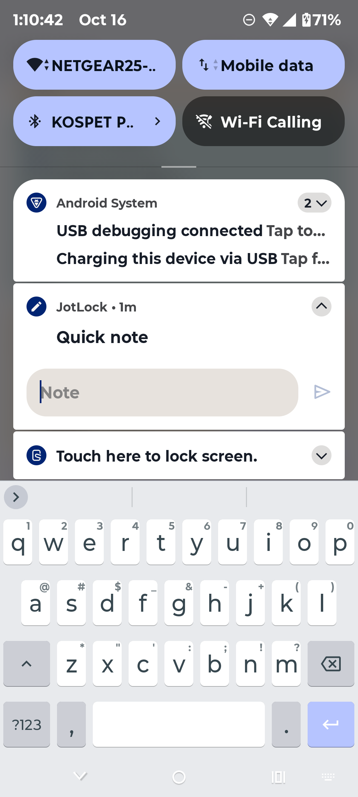
</p>

### Checklists that finish themselves

Start any line with `[ ]` — or `[x]` when it's already done — and JotLock
renders it as a tappable checkbox right on the note card, with a *2/6*-style
progress count in the subtitle. Complete every item on a note that has a
reminder and the reminder clears itself — done means done. Checklists are
plain text, so they read fine in text exports and survive JSON backups.

<p align="center">
  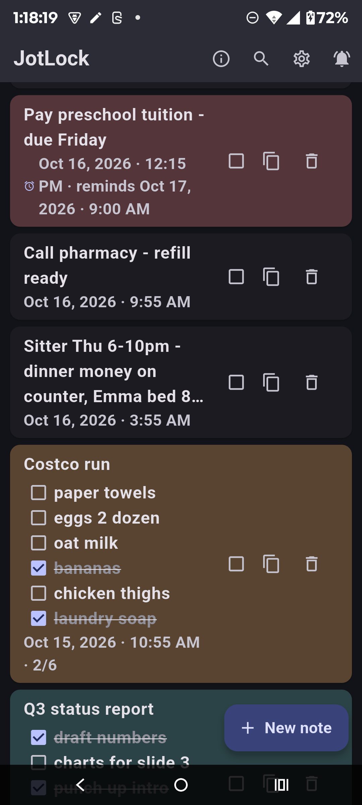
  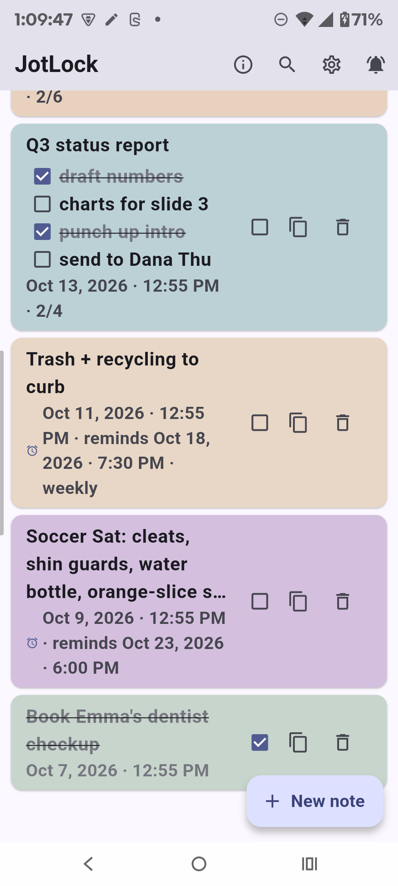
</p>

### Reminders that stay out of the way

Long-press any note → **Remind me…** — pick 10 minutes, 1 hour, tomorrow 9 AM, or
any custom date and time. When it fires you get a heads-up with your sound
(your choice, or none) and tapping it opens the note ready to edit. Reminder cards
**never appear on the lock screen** — your jot button stays alone up there.

<p align="center">
  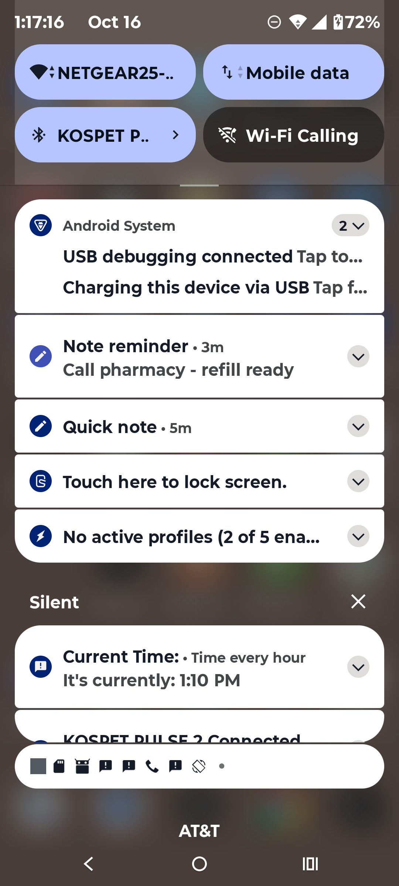
</p>

### …and repeat on your schedule

A reminder doesn't have to be one-shot: set it to **Every day**, **Every week**,
or a custom interval — every 2 days, every 3 weeks, whatever the chore needs.
Repeating reminders re-arm themselves each time they fire and show up in the
note's subtitle (`· every 3 days`, `· weekly`).

<p align="center">
  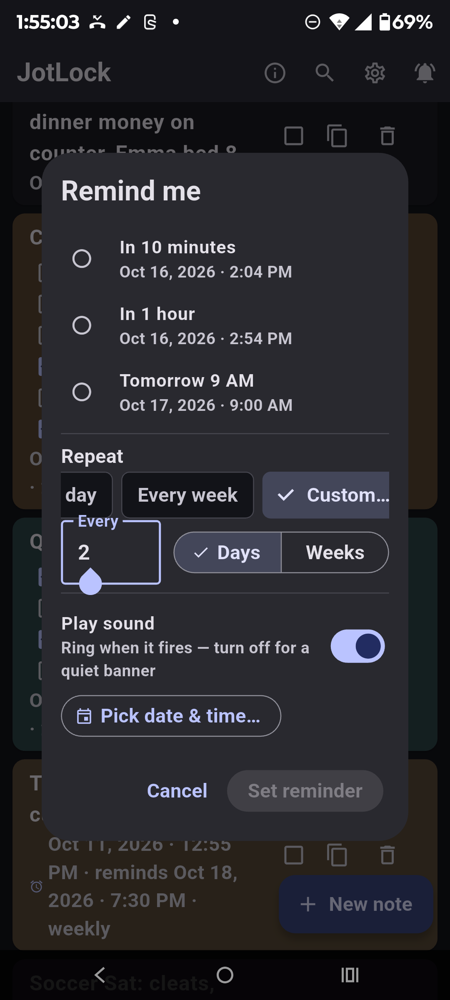
  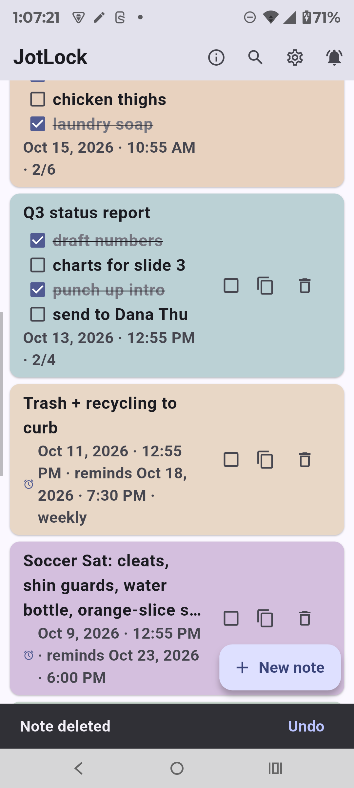
</p>

### Color-code your priorities

Long-press any note and tap a swatch — seven colors (red, orange, yellow, green, blue,
purple, teal) tint the note card so pressing items stand out while you scroll. Colors
carry across JSON backups, work in light and dark themes, and none is the default.

<p align="center">
  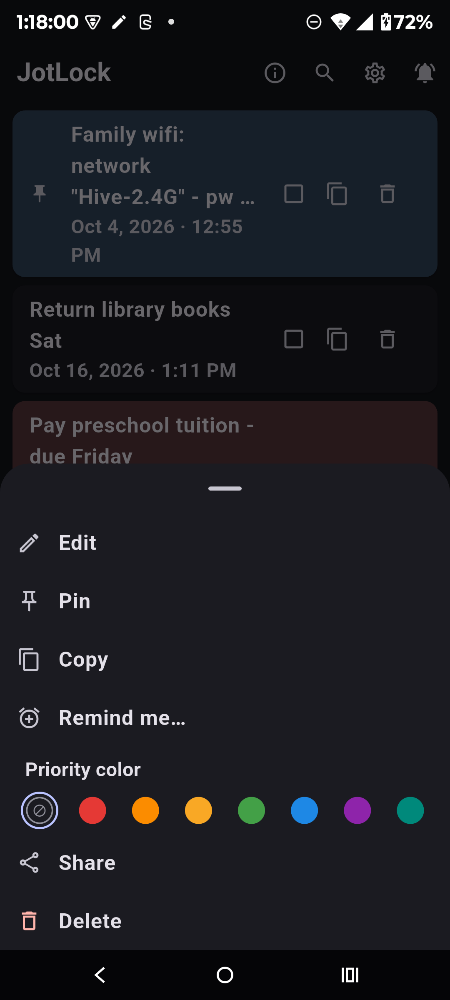
</p>

### Backup in one tap

Export all notes as JSON or readable text, import a JSON backup to merge (duplicates
skipped) — handy for moving to a new phone. Checklists, repeat intervals, reminder
times and colors all survive the round-trip.

<p align="center">
  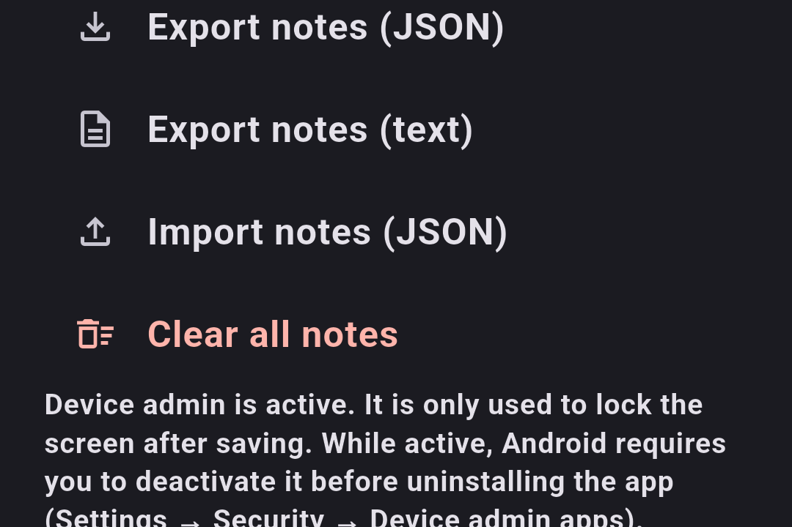
</p>

### Find anything fast

The magnifier searches every note as you type — case-insensitive, across titles,
body text and checklist items.

<p align="center">
  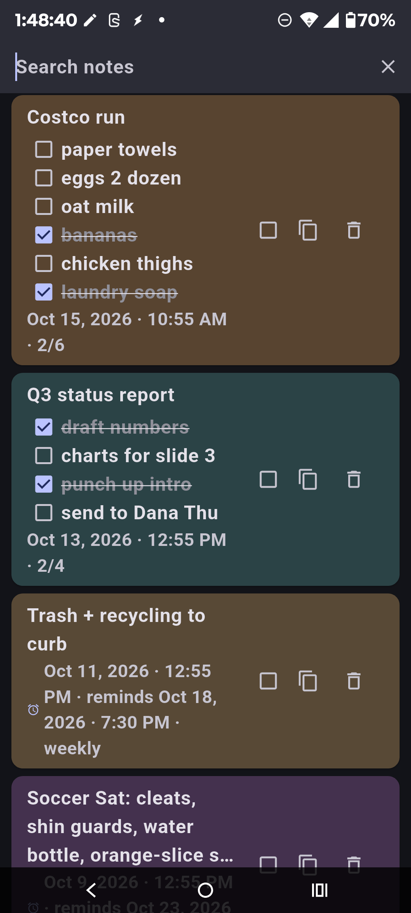
</p>

### Small touches everywhere

Delete a note by accident? The snackbar undoes it. Material 3 with true light
and dark themes, adaptive and themed icons — polish where you'd never think
to look.

<p align="center">
  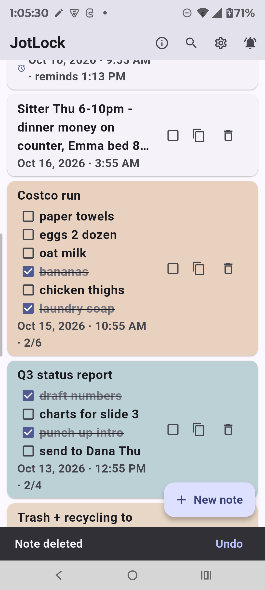
</p>

### Free, open source, and ad-free

The info icon in the app bar opens **About & support** — a note from the
developer, donation links, and the GitHub source. If JotLock saves you time,
a small donation keeps it free, open source, and ad-free.

<p align="center">
  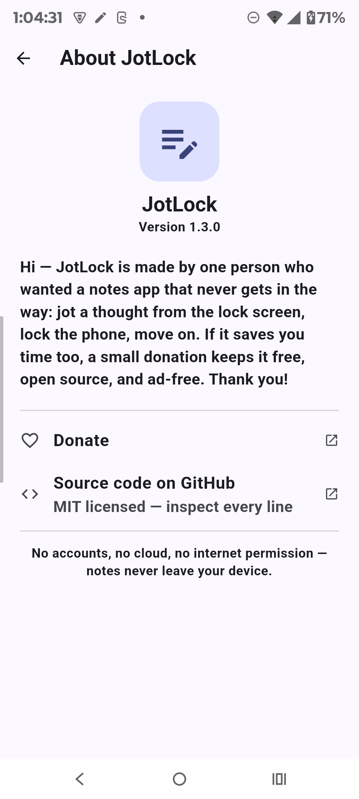
</p>

---

## Features

| Feature | What it does |
|---|---|
| **Lock screen capture** | A persistent *Quick note* notification gives you a **Write note** button — start a note from the lock screen. Survives reboots. Your keyguard (PIN/fingerprint) confirms it's you first — Android's rule, and your notes' bodyguard. |
| **Inline capture (Jot)** | While unlocked, the notification's **Jot** action expands a text field directly in the shade — even inside other apps. |
| **Auto re-lock after saving** | Three options: **Lock the phone**, **Show the home screen**, or **Stay on the confirmation**. |
| **Checklists** | Start any line with `[ ]` (or `[x]` when done) — it renders as a tappable checkbox with an n/total progress count. Completing a list clears its reminder automatically. |
| **Reminders** | Presets, custom date & time, or repeat — every day, every week, or every N days/weeks. Heads-up banner with your sound; opens the note pre-filled on tap. |
| **Reminder sound** | Pick any system notification sound globally, or mark individual reminders silent. |
| **Background keep-alive** | One-time "Allow" makes the capture card and reminders reliable through doze. |
| **Pin notes** | Pinned notes float to the top with a badge. |
| **Priority colors** | Long-press a note and pick from a 7-color palette — the card gets a matching tint so priorities are visible while scrolling. Survives backups. |
| **App PIN (optional)** | A 4–8 digit PIN asked when opening the app. Stored as a salted hash — lock-screen capture stays instant. |
| **Search** | Case-insensitive search over all notes, including checklist lines. |
| **Copy / share** | Copy any note to the clipboard, or share it out. JotLock also accepts text sent **in** from the share sheet and the text-selection menu. |
| **Export / import** | JSON backup (share it anywhere) and a readable text export. |
| **Notification toggle** | Don't want the persistent card? Turn it off in settings; it returns on next launch. |
| **About & support** | The info icon in the app bar opens a developer note, support links, and the GitHub source. |
| **Polish** | Material 3, light/dark, adaptive + themed icons, undo snackbar after deletes. |

---

## Install

Grab the APK from [Releases](../../releases) — every release attaches four:

| APK | Pick it for |
|---|---|
| `JotLock-v…-arm64-v8a.apk` | Most phones (64-bit ARM) |
| `JotLock-v…-armeabi-v7a.apk` | Older 32-bit phones |
| `JotLock-v…-x86_64.apk` | Emulators, x86 devices |
| `JotLock-v….apk` (universal) | Any device — biggest download, all CPUs in one file |

**Automatic updates:** [Obtainium](https://github.com/ImranR98/Obtainium) (FOSS) —
install it, add this repo (`https://github.com/Ryfire/jotlock`), and updates arrive
straight from Releases. The per-ABI APKs carry a higher version code than the
universal one, so updates always install cleanly over what you started with.

## Getting started

1. **Allow notifications** when Android asks (Android 13+).
2. Optional — for *Lock the phone* mode: pick it in Settings and activate the
   device-admin prompt Android shows (see below).
3. Recommended — Settings → **Keep running in background** → **Allow**, so the
   capture card and reminders stay reliable.

## How to use

### From the lock screen

1. Tap the jot pencil (or the **Write note** button on the Quick note card).
2. Type your note, tap **Save note**.
3. Depending on your *After saving* setting the phone locks instantly, goes home,
   or stays put — the next wake is always the lock screen, never the app.

With *Stay on the confirmation*, saving hands you the choice — **Lock screen**
or **Go home**, or just let the screen turn off:

<p align="center">
  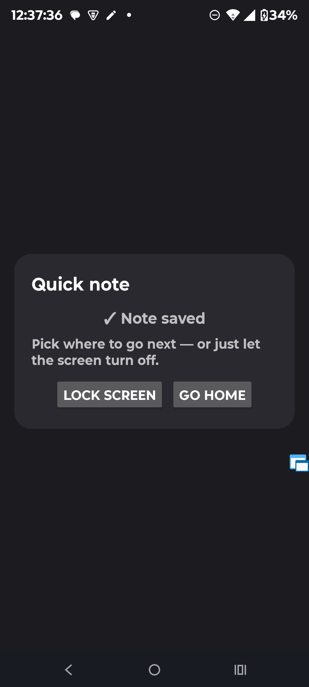
</p>

> **Why the PIN prompt?** If your phone uses a PIN/fingerprint, Android asks for a
> quick confirmation before showing the capture screen — an OS security rule for
> every app that surfaces over the lock screen, not a JotLock setting. It cuts both
> ways, though: without that check, anyone holding your locked phone could jot
> whatever they liked straight into your notes. JotLock's optional **App PIN** is a
> separate thing — it guards the management app only, so lock-screen capture stays
> one tap away for *you*.

### From the shade (inline Jot)

1. Pull down the notification shade anywhere — home screen or inside any app.
2. Tap **Jot** on the Quick note card, type, send.
3. Done — you stay exactly where you were.

### Checklists

1. Start a line with `[ ]` — that's it, it becomes a checkbox. Mark done items
   with `[x]`.
2. Tap the checkbox right on the card to flip an item; the subtitle shows
   progress like `2/6`.
3. Complete every item on a note with a reminder and the reminder clears
   itself — done means done, recurring included.

Plain lines in the editor, tappable checkboxes on the card:

<p align="center">
  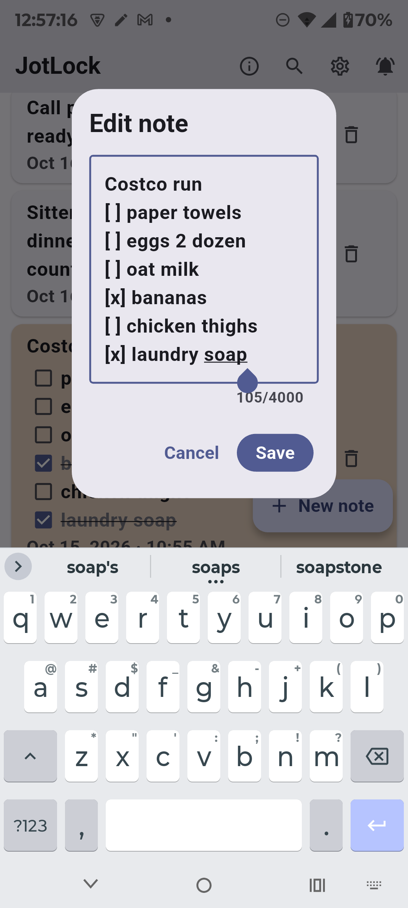
</p>

### Reminders

1. **Long-press a note** (or tap it → menu) → **Remind me…**
2. Pick a preset or *Pick date & time…*, choose whether it should play your
   sound, optionally set **Repeat** (every day, every week, or custom), and
   tap **Set reminder**.
3. When it fires, tap the card to edit the note. One-shot reminders fire once
   and clear; repeating ones reschedule themselves until you remove the
   reminder or the note.

The reminder sound itself (what "play sound" uses) is set in Settings →
**Reminder sound**.

### In the app

- **Tap a note** to edit · **Tap a checkbox** to check it off · **Copy** / **Delete** icons on each note
- **Long-press** for the full menu: *Edit · Pin · Copy · Remind me… · Priority color · Share · Delete*
- **Magnifier** to search · **＋ New note** to add
- **Info icon** — About & support: a note from the developer, donation links, and the source code

---

## Settings

| Setting | What it's for |
|---|---|
| After saving a note from the lock screen | Lock the phone · Show the home screen · Stay on the confirmation |
| Reminder sound | The sound sounded reminders play — system picker, Silent included |
| Keep running in background | One-time allow so the card + reminders survive battery doze |
| App PIN | Optional 4–8 digit gate on the app UI — set, change, or remove from Settings |
| Export / Import | JSON backup round-trip, plus a readable text export |
| Clear all notes | Wipes everything (after confirmation) |

---

## Privacy & permissions

JotLock is offline-only. There is **no INTERNET permission**, so it cannot send
anything anywhere — notes physically have nowhere to go but your device.

| Permission | Why |
|---|---|
| Notifications | The Quick note card and reminder alerts. |
| Exact alarms | Reminders fire on time even after a reboot or overnight idle. |
| Background (battery) | Optional one-time allow so capture/reminders survive doze. |
| Device admin (force-lock) | Optional, only for *Lock the phone* mode — see below. |

### Optional App PIN

<p align="center">
  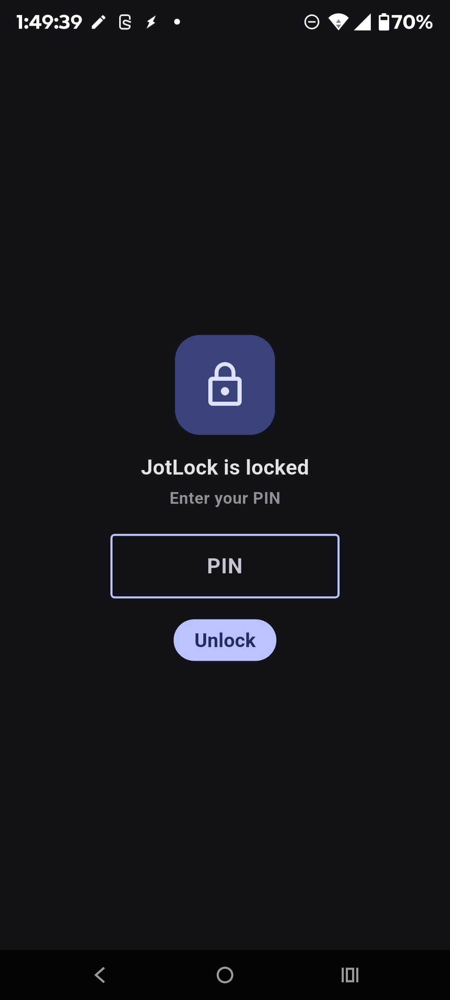
</p>

The 4–8 digit App PIN guards the note list only — lock-screen capture and the
shade **Jot** field stay instant by design. It's stored as a salted hash, so
the digits themselves are never saved. Forgot it? Reinstalling clears it —
and the notes — so keep a backup before setting one.

### About device admin

*Lock the phone* after saving needs Android's only sanctioned way for an app to
re-lock the screen: the `force-lock` device-admin policy. That is the **single
policy** JotLock declares — Android itself forbids an admin from using anything it
hasn't declared, so wiping data, changing passwords, camera access and the rest are
structurally out of reach. Activation is opt-in (only when you pick that mode) and
revocable anytime via **Settings → Security → Device admin apps → JotLock**.

---

## Good to know

- The lock-screen card needs your phone's *Lock screen → Notifications* set to
  **Show** (the default).
- A few phone skins render inline reply fields inconsistently; the plain buttons
  (**Write note** / **Save note**) work everywhere.
- Notes are capped at 500 (oldest trimmed) and 4,000 characters each.
- Checklists are plain `[ ]` / `[x]` text lines — readable in any editor, and
  preserved by JSON backups and imports.
- The optional App PIN guards the note list only — lock-screen capture and the
  shade **Jot** field stay instant by design. It is a privacy screen, not
  encryption: notes stay plain JSON in app storage and reminder cards still
  show note text in the shade. Forgot the PIN? Reinstalling clears it — and
  the notes — so keep a backup before setting one.
- While device admin is active, Android blocks uninstalling until you deactivate it
  (a safety rule, not JotLock lock-in).

---

## Tested on

JotLock is developed and exercised daily on one **Android 15** phone —
lock-screen capture, inline Jot, the keyguard prompt, reminders, and
force-lock are all verified there. Treat that as the compatibility baseline.
Other OEM skins (Samsung One UI, Xiaomi HyperOS and friends) restyle lock
screens and battery management aggressively, so expect some variation until
it's reported and fixed.

Running JotLock on something else? Tell us in
[Discussions](../../discussions) — whether it works or not, device reports
make the app better (and feed the F-Droid packaging later).

---

## Building from source

Flutter + Android SDK; see [docs/DEVELOPMENT.md](docs/DEVELOPMENT.md) for setup,
architecture and release signing.

```bash
flutter pub get
flutter run
```